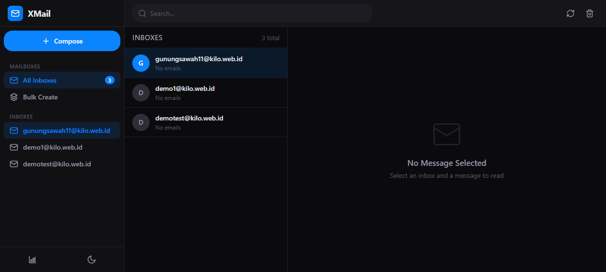
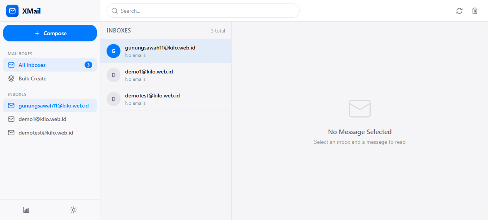
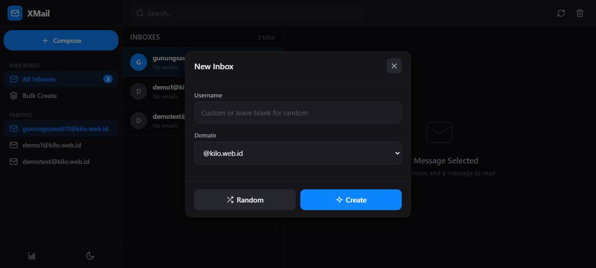
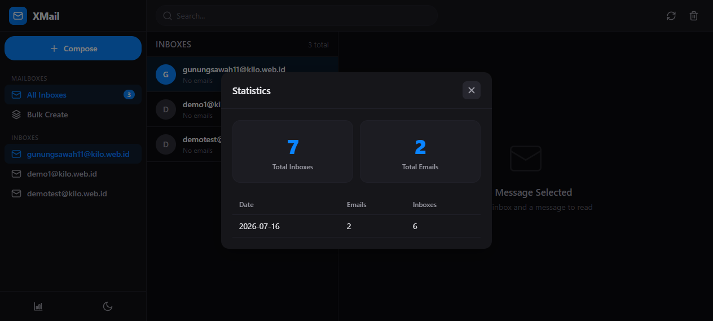

<div align="center">

# XMail

**Enhanced disposable email service on Cloudflare Workers**

A modern, self-hosted disposable email platform with a Gmail-inspired 3-pane interface. Built on Cloudflare's edge network — zero server costs, infinite scale.

[](https://workers.cloudflare.com/)
[](https://www.typescriptlang.org/)
[](https://hono.dev/)
[](https://developers.cloudflare.com/d1/)
[](LICENSE)

</div>

---

## Screenshots

### Dark Theme — Desktop



### Light Theme — Desktop



### New Inbox Modal



### Statistics



### Mobile Responsive


---

## Features

| Feature | Description |
|---------|-------------|
| **Modern Email UI** | Gmail-inspired 3-pane layout — sidebar, inbox list, reading pane |
| **Fully Responsive** | Desktop 3-pane → Tablet 2-pane → Mobile single column with slide-in detail |
| **OTP Auto-Extract** | Automatically detects and highlights verification codes from email body |
| **HTML Email Support** | Renders HTML emails in sandboxed iframe |
| **Dark / Light Theme** | Toggle between themes — preference saved to localStorage |
| **Webhook Forwarding** | POST to your URL when an email arrives — perfect for bot triggers |
| **Telegram Notifications** | Real-time email notifications to Telegram (per-inbox configurable) |
| **Auto-Expiry (Cron)** | Inboxes auto-delete after configurable TTL via Cron Trigger |
| **Message Pruning** | Keeps max N messages per inbox to prevent D1 bloat |
| **Stats Dashboard** | Daily email/inbox counts, total counts |
| **Bulk Inbox Creation** | Create up to 100 inboxes at once, export to clipboard |
| **Search** | Real-time search across inbox list |
| **Attachment Metadata** | Captures filename, size, and content type |
| **API Key Auth** | Optional protection for sensitive endpoints |
| **SVG Icons** | Clean, consistent icon set — no emoji |

---

## Tech Stack

| Layer | Technology |
|-------|-----------|
| **Runtime** | Cloudflare Workers |
| **Framework** | Hono |
| **Email Parsing** | PostalMime |
| **Database** | Cloudflare D1 (SQLite) |
| **Cron** | Cloudflare Cron Triggers |
| **Static Assets** | Cloudflare Workers Assets |
| **Language** | TypeScript |
| **CLI** | Wrangler v4 |
| **Frontend** | Vanilla JS SPA — no framework, no build step |

---

## Quick Start

```bash
# 1. Clone & install
git clone https://github.com/kiosapi/XMail.git
cd XMail
npm install --legacy-peer-deps

# 2. Login to Cloudflare
npx wrangler login

# 3. Create D1 database
npx wrangler d1 create xmail-db
# Copy the database_id into wrangler.toml

# 4. Apply schema
npx wrangler d1 execute xmail-db --remote --file=src/db/schema.sql

# 5. Deploy
npx wrangler deploy

# 6. Enable Email Routing + set catch-all → Worker in Cloudflare Dashboard
```

---

## Configuration

All config is in `wrangler.toml` under `[vars]`:

| Variable | Default | Description |
|----------|---------|-------------|
| `APP_NAME` | `XMail` | Display name |
| `MAIL_DOMAIN` | `kilo.web.id` | Domain for email addresses |
| `WEB_HOST` | `mail.kilo.web.id` | Web UI hostname |
| `AUTO_EXPIRY_HOURS` | `24` | Inbox TTL in hours (0 = never) |
| `MAX_MESSAGES_PER_INBOX` | `100` | Max messages per inbox (0 = unlimited) |

### Secrets (optional)

```bash
# API key auth (comma-separated, empty = auth disabled)
npx wrangler secret put API_KEYS

# Telegram bot token for notifications
npx wrangler secret put TG_BOT_TOKEN
```

---

## API Reference

### Authentication

- **Session endpoints**: use `x-session-id` header (anonymous sessions)
- **Protected endpoints** (stats, search, admin): require `x-api-key` header

### Endpoints

| Method | Path | Description |
|--------|------|-------------|
| `GET` | `/api/config` | App configuration |
| `GET` | `/api/session` | Create/retrieve session |
| `GET` | `/api/inboxes` | List session inboxes |
| `POST` | `/api/inboxes` | Create inbox `{localPart?, domain?, label?}` |
| `POST` | `/api/inboxes/bulk` | Bulk create `{count, domain?}` |
| `DELETE` | `/api/inboxes/:address` | Delete inbox (`?purge=1`) |
| `GET` | `/api/inboxes/:address/messages` | List messages |
| `GET` | `/api/inboxes/:address/messages/:id` | Get single message |
| `GET` | `/api/inboxes/:address/otp` | Get latest OTP code |
| `GET` | `/api/inboxes/:address/settings` | Get inbox settings |
| `PUT` | `/api/inboxes/:address/settings` | Set webhook/Telegram |
| `GET` | `/api/stats` | Daily + total stats |
| `GET` | `/api/search?q=` | Search messages |
| `POST` | `/api/admin/expire` | Manual expiry trigger |

### Example Flow

```bash
# 1. Get session
SESSION=$(curl -s https://mail.kilo.web.id/api/session | jq -r '.sessionId')

# 2. Create random inbox
INBOX=$(curl -s -X POST https://mail.kilo.web.id/api/inboxes \
  -H "x-session-id: $SESSION" \
  -H "Content-Type: application/json" \
  -d '{}' | jq -r '.address')

# 3. Wait for email, then check OTP
curl -s "https://mail.kilo.web.id/api/inboxes/$(urlencode $INBOX)/otp" \
  -H "x-session-id: $SESSION"
```

---

## Project Structure

```
XMail/
├── wrangler.toml              # Worker config, D1, routes, cron
├── package.json
├── tsconfig.json
├── screenshots/               # README screenshots
│   ├── dashboard-dark.png
│   ├── dashboard-light.png
│   ├── new-inbox-modal.png
│   ├── stats-modal.png
│   └── mobile-view.png
└── src/
    ├── index.ts               # Entry: fetch() + email() + scheduled()
    ├── email-handler.ts       # Inbound email (OTP, webhook, TG)
    ├── api/
    │   └── routes.ts          # Hono router: all API endpoints
    ├── db/
    │   ├── schema.sql         # D1 tables (6 tables)
    │   └── queries.ts         # Typed query functions
    ├── utils/
    │   ├── random-address.ts  # Human-like random email generator
    │   └── otp.ts             # OTP code extractor
    └── web/
        ├── index.html         # SPA shell
        ├── app.js             # Frontend SPA (vanilla JS)
        └── styles.css         # Modern responsive design system
```

---

## Responsive Breakpoints

| Width | Layout |
|-------|--------|
| `> 1024px` | Full 3-pane: sidebar (260px) + inbox list (340px) + reading pane |
| `769–1024px` | Narrower sidebar (220px) + inbox list (300px) + reading pane |
| `481–768px` | Sidebar becomes drawer + inbox list full width + reading pane slides in |
| `≤ 480px` | Mobile: single column, slide-in reading pane, hamburger menu |

---

## License

MIT
